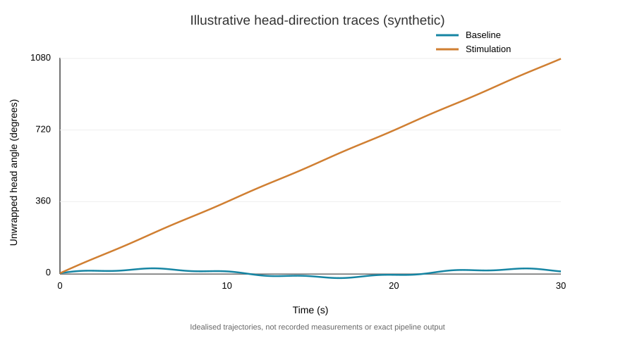

# Head direction analysis from pose-tracking data

During my PhD, I used DeepLabCut and custom analysis code to quantify animal behaviour, including head direction and repeated turning. I've put together a small Python example of the analysis steps, from tracked body points to angular measurements and behavioural summaries.

The example uses **synthetic pose data**, so it can be run without the original lab recordings. This is a retrospective demonstration, **not a copy of my original PhD scripts**. It illustrates analysis of tracking outputs, **not the training of a DeepLabCut model**.

## What the code does

- Loads frame-by-frame nose and neck positions with tracking confidence scores.
- Filters low-confidence points and interpolates short gaps.
- Calculates head angle with NumPy and unwraps angles across the ±180° boundary.
- Estimates angular speed and counts clockwise and anticlockwise turning events.
- Exports processed traces, per-condition summaries and a figure.

## Getting started

Requires Python 3.10+.

```bash
python -m pip install -r requirements.txt
python -m src.analysis --output-dir outputs
```

The command generates two synthetic sessions (`baseline` and `stimulation`), analyses both and writes a PNG figure and CSV outputs into `outputs/`.

To run the tests:

```bash
python -m unittest discover -s tests -v
```

There is also a short [notebook](demo.ipynb) for stepping through the example interactively.

## Example output



The repository includes an illustrative SVG preview of the generated trajectory shape. Running the script produces the full PNG figure (`outputs/head_angle_demo.png`), processed traces and synthetic pose-data CSVs on your own machine.

With the default synthetic data, the analysis identifies **three anticlockwise rotations** in the stimulation session and **none** in the baseline session. These are expected results for generated trajectories, not observations from an experiment.

| Generated file | Contents |
| --- | --- |
| `synthetic_pose_data.csv` | Generated coordinates and tracking confidence |
| `head_angle_trace.csv` | Filtered coordinates, head angles and angular speed |
| `summary.csv` | Total angular travel and directional turn counts |
| `head_angle_demo.png` | Comparison of unwrapped head-angle traces |

The repository includes a small [example summary](outputs/summary.csv). The larger synthetic CSVs and PNG can be regenerated with the command above.

## Using another dataset

Pass a CSV file with pose-tracking coordinates:

```bash
python -m src.analysis --csv path/to/pose_data.csv --output-dir outputs
```

Required columns are `condition`, `time_s`, `nose_x`, `nose_y`, `neck_x`, `neck_y`, `likelihood_nose`, and `likelihood_neck`.

If you're starting with a standard DeepLabCut multi-index CSV export, first map its selected body-part columns to this format. The turn detector uses configurable speed and near-complete-turn thresholds (330° by default); these should be checked against annotations before drawing conclusions about real data.

## Research background

The project draws on the head-direction work described in **Chapter 9** of my PhD thesis, *The Role of Head Direction Cell Activity on Head Direction Behaviour*.

[Read the thesis](https://pastel.hal.science/tel-04457300v1)
